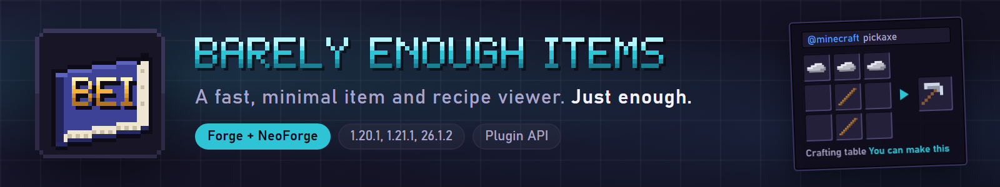
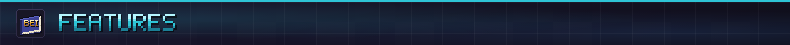
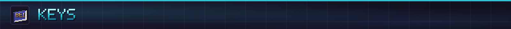
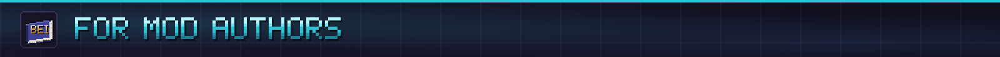
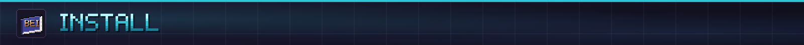
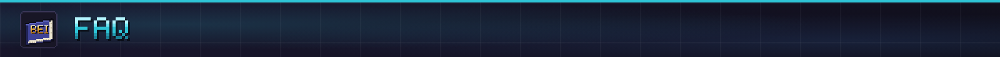

**Find any item, see every recipe, and plan the whole craft, in a viewer that stays out of your way.**

Barely Enough Items (BEI) is a minimalist, fast item and recipe viewer for Minecraft on Forge and NeoForge. The item browser sits against the right edge of inventory screens, recipes open in a slim popup grouped by station, and the Master Blueprint breaks any item into a nested crafting plan pinned to your HUD.

**Full guide:** [itmecasey.com/wiki/bei](https://itmecasey.com/wiki/bei/)

- **Item browser:** opens with every item (and every potion, enchanted book and other variant) and searches in the background, so opening a screen never waits. Use `@mod`, `#tag`, `$tooltip` and `-exclude`, plus category icons and a scrollbar.
- **Recipe popup:** recipes grouped by station (the ones you can make come first), uses lookups, centered 3x3 crafting cards, and a `+` button that fills the crafting grid, furnace, stonecutter or smithing table from your inventory. Hold Shift for a full stack.
- **Master Blueprint:** press `P` on any item to make it your project. BEI builds a dependency tree, checks your inventory (and optionally your ender chest and storage that other mods add), shows the next craft or what to gather, and pins a percent-done HUD.
- **Themes:** dark and light built in, themes from datapacks, adjustable backdrop opacity, draggable windows and rarity-colored item tooltips.
- **Cheat mode:** Ctrl+click the gear, then click items to hold or place them with no commands. Needs creative mode, operator permission, or your own singleplayer world.

| Key | Does |
|---|---|
| `R` on an item | Recipes that make it |
| `U` on an item | Recipes that use it |
| `P` on an item | Make it your Master Project (again to clear) |
| `J` | Open the full project tree |
| `H` | Show or hide the project HUD |
| `/` | Focus the search box |

- **Groups and hidden items:** a datapack can fold many items into one browser cell (wool, planks, logs) or hide items and whole mods from the browser. The server sends them when you join, and `/reload` resends them.
- **ModJS:** with [ModJS](https://github.com/ItMeCasey/ModJS) installed, its scripts can hide items, group items, hide recipe types and add information pages.

Add your own recipe categories, recipes and card looks with a **plugin**: mark a class `@BeiPlugin` and BEI finds it on its own, with no hard dependency, so your mod works fine without BEI installed. `./gradlew apiJar` builds just the API package. [Plugin guide](https://itmecasey.com/wiki/bei/)

| Minecraft | Loaders |
|---|---|
| 26.3 | Forge, NeoForge |
| 26.2 | Forge, NeoForge |
| 26.1.2 | Forge, NeoForge |
| 1.21.1 | Forge, NeoForge |
| 1.20.1 | Forge, NeoForge |

Pick the file that matches your Minecraft version and loader, and put it in your `mods` folder. Open any inventory screen and the browser is on the right edge.

**Does it need to be on the server?** Browsing and search work on the client alone. On 26.1.2, 26.2 and 26.3 the server must also have BEI for recipes to show, because the game only gives a client the recipes it has unlocked. Datapack themes, groups, hidden items and cheat mode need BEI on the server in every version. On 1.21.1 and 1.20.1 recipes come with the game.

**Does it work with JEI?** No. BEI is its own viewer and has its own plugin API.

**Can I use it in my modpack?** Yes. It's MIT licensed.

Source and issues on [GitHub](https://github.com/ItMeCasey/BEI).
